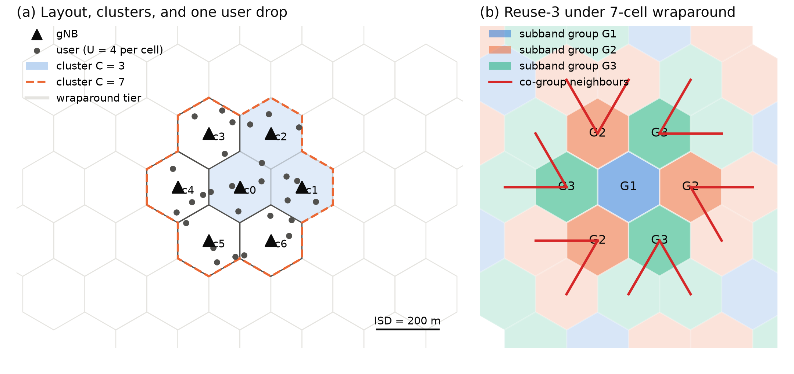

# 새 논문 계획: 5G/6G 다중 셀 협조 스케줄링의 정확 oracle 손실 분석

- 상태: **계획 초안** (파일럿 실행 후 확정)
- 작성일: 2026-11-11
- 브랜치: `docs/paper3-5g-multicell-plan`
- 관련 문서: `paper/main.tex` (paper1), `experiments/headroom_model.py`, `docs/random_topology_experiment_plan.md`
- 가제: *How Far Are Learned Multi-Cell Schedulers From the Optimum? An Exact-Oracle Gap Analysis of CTDE for
  Coordinated Scheduling in 5G NR*

## 1. 동기

paper1은 IEEE 802.11bn MAPC에서 다음을 보였다.

1. 협조 이득(정확 oracle 대비 Co-TDMA 손실)은 제공 부하가 Co-TDMA 용량을 넘을 때($\rho > 1$)만 열리고,
   파라미터 없는 유체(fluid) 모델이 그 분산의 98–99%를 설명한다.
2. 학습 스케줄러의 손실은 MCS 선택(링크 적응)이 가장 크고, AP 간 정보의 몫은 작다.
3. Co-TDMA 하나가 아니라 "Co-TDMA와 SINR 기준 중 나은 쪽"과 비교해야 학습 이득을 주장할 수 있다.

이 결론이 **WLAN에만 해당하는지, 협조 스케줄링 일반의 성질인지**는 열린 질문이다. 셀룰러 다중 셀 협조
스케줄링(CoMP coordinated scheduling, O-RAN near-RT RIC)은 같은 질문을 던지기에 가장 가까운 환경이다.

- 구조가 CTDE와 정확히 맞는다. RIC가 중앙에서 학습하고, 각 기지국(gNB/DU)이 지역 정보로 실행한다.
- WLAN과 다른 점이 결론을 시험한다. OFDMA 자원 블록(PRB) 여러 개, 비례 공정성(PF) 스케줄링이 표준,
  CQI 피드백 지연, 이동 속도에 따른 채널 노화, 링크 적응의 표준 해법(OLLA)이 있다.
- paper1의 SINR·MCS·oracle·학습자 코드를 대부분 재사용한다(9절).

## 2. 연구 질문과 가설

| 번호 | 질문 | 가설 |
|---|---|---|
| RQ1 | 셀룰러에서도 협조 이득은 "직교 재사용 기준의 용량을 넘는 부하"에서만 열리는가? | 성립한다. 유체 모델(paper1 식)을 PRB 단위로 확장하면 분산의 대부분을 설명한다 |
| RQ2 | 학습 스케줄러 손실의 분해(링크 적응 / 정보 / 최적화)는 WLAN과 같은 순서인가? | OLLA가 표준이므로 링크 적응 몫은 ARF보다 작아지고, 정보 몫은 CQI 지연이 클수록 커진다 |
| RQ3 | CQI 피드백 지연과 이동 속도는 어느 손실을 키우는가? | 지연·속도가 커지면 정보 몫과 링크 적응 몫이 함께 커지고, oracle 대비 협조 이득은 줄어든다 |
| RQ4 | 목적함수를 처리량에서 PF로 바꾸면 결론이 바뀌는가? | 협조 이득은 셀 가장자리 사용자에게 몰리므로 PF에서 더 크다 |
| RQ5 | 협조 클러스터 크기(셀 3개 → 7개)가 커지면 학습자의 최적화 손실은 어떻게 변하는가? | 행동 공간이 커지면서 최적화 손실이 커지고, 정보 몫은 그대로다 |

## 3. 시스템 모델

### 3.1 배치와 클러스터

- 7셀 육각 배치(가운데 셀 + 1층 6셀), 무지향성, wraparound로 경계 효과 제거.
  셀 간 거리(ISD) 200 m (3GPP UMi 기준, 가정).
- **협조 클러스터** $\mathcal{C}$: 크기 $C \in \{3, 7\}$. 클러스터 밖 셀은 항상 재사용-1 PF로 전송하는
  배경 간섭으로 둔다(CoMP 클러스터 개념).
- 셀당 사용자 수 $U \in \{2, 4, 6\}$, 셀 안 균일 무작위 배치(drop). 셀 가장자리 사용자 비율을 별도 요인으로 둘지
  파일럿에서 결정.

그림(`docs/figures/make_paper3_topology.py`): (a) 7셀 배치, 클러스터 $C = 3$(c0–c2, 서로 인접)과 $C = 7$,
사용자 drop 한 개, wraparound 1층. (b) 7셀 wraparound에 재사용-3을 얹으면 같은 그룹 셀이 경계를 넘어 맞닿는다
(빨간 선, 가운데 클러스터에 닿는 쌍만 12개). 7은 3의 배수가 아니므로 위치 기반 재사용-3은 7셀 wraparound와
양립하지 않는다. 대응은 5절 B2와 12절에 적었다.

### 3.2 채널 (3GPP TR 38.901 UMi를 단순화, 수치는 원문 확인 후 확정)

- 반송파 3.5 GHz, 경로손실은 UMi-Street Canyon LOS/NLOS 식, LOS 확률 포함.
- 섀도잉: 로그정규, 표준편차 LOS 4 dB / NLOS 7.82 dB, drop 동안 고정.
- 주파수 선택적 페이딩: 부대역(subband)마다 독립 Rayleigh, 시간 상관은 이미 구현된 Gauss–Markov 페이딩
  (`--fading-rho`, 커밋 `04f1078`)을 재사용. $\rho = J_0(2\pi f_D T_{\text{slot}})$.

| 속도 | 도플러 $f_D$ (3.5 GHz) | $\rho$ ($T_{\text{slot}} = 1$ ms) | $\rho$ ($T_{\text{slot}} = 0.5$ ms) |
|---|---|---|---|
| 3 km/h | 9.7 Hz | 0.9991 | 0.9998 |
| 30 km/h | 97.2 Hz | 0.909 | 0.977 |
| 60 km/h | 194.4 Hz | 0.660 | 0.909 |

### 3.3 자원과 행동

- 슬롯 길이 1 ms (numerology 0, 15 kHz). 대역을 $B \in \{1, 4\}$개 부대역으로 나눈다.
- 슬롯 $t$, 부대역 $b$에서 셀 $c$는 사용자 하나 또는 침묵(mute)을 고르고 MCS를 정한다.
  송신 전력은 고정(전력 제어는 확장 항목).
- MCS: CQI 표(TS 38.214 Table 5.2.2.1-2, 15단계, 스펙트럼 효율 0.15–5.55 bit/s/Hz)와 SINR 임계값 매핑.
  임계값은 링크 수준 결과에서 흔히 쓰는 근사(약 −6.7 ~ 22.7 dB)를 쓰고, **가정으로 표시**한다.
  BLER은 임계값 계단 모델(paper1과 같음).

### 3.4 트래픽과 목적함수

- **전체 버퍼(full buffer)**: 주 시나리오. 부대역끼리 큐를 공유하지 않으므로 oracle이 부대역별로 분리된다(4절).
- **유한 버퍼**: Poisson 도착 또는 3GPP FTP Model 3. RQ1의 부하 스윕에 쓴다. 부대역끼리 큐가 결합되므로
  oracle은 작은 설정($C = 3$)에서만 정확하게 푼다.
- 목적함수: (i) 슬롯 처리량 합, (ii) PF 가중 합 $\sum_k R_k(t) / \bar{R}_k(t)$ (평균 처리량 $\bar{R}_k$는 지수 이동 평균).
  두 경우 모두 슬롯 단위로는 정확한 최적해를 구한다.

### 3.5 관측

- 셀 $c$의 지역 관측: 자기 사용자의 CQI($d_{\text{CQI}}$ 슬롯 지연, 부대역별), 버퍼 길이, PF 평균 처리량,
  이웃 셀의 평균 간섭 세기.
- 정보 수준 $b \in \{0, \infty\}$ (paper1과 같은 MAPPO / Central PPO 대비). 필요하면 VQ 비트 수 $b$ 스윕으로 확장.

## 4. 정확 oracle

- 전체 버퍼에서는 부대역 $b$마다 독립이므로, 부대역별로 $\prod_{c \in \mathcal{C}} (U + 1)$개 조합을 전수 탐색하고
  각 링크에 해독 가능한 최고 MCS를 준다(paper1 식 `best_mcs`와 같은 구조).
- 탐색 크기 $(U+1)^C$:

| $U$ | $C = 3$ | $C = 7$ |
|---|---|---|
| 2 | 27 | 2,187 |
| 4 | 125 | 78,125 |
| 6 | 343 | 823,543 |

- $C = 3$은 모든 $U$에서 paper1과 같은 수준으로 가볍다.
- $C = 7$은 $U \le 4$까지 벡터화한 전수 탐색(부대역 4개면 슬롯당 약 31만 조합)으로 평가용으로는 감당 가능할 것으로
  보지만, **파일럿에서 실행 시간을 먼저 잰다**. 너무 느리면 PF 지표 상위 $K$명만 후보로 두는 대신 그 경우 oracle을
  "후보 제한 oracle"로 부르고 분기 한정(branch-and-bound)으로 정확해를 확인한 표본을 함께 보고한다.
- paper1과 같이 oracle은 슬롯 단위로만 최적이며, 이 점을 한계로 명시한다.

## 5. 비교 대상

| ID | 이름 | WLAN 대응 | 설명 |
|---|---|---|---|
| B1 | 재사용-1 PF (비협조) | 모든 AP 전송 SINR 기준 | 모든 셀이 모든 부대역에서 PF 최대 사용자에게 전송 |
| B2 | 클러스터 시분할 (cluster TDMA) | Co-TDMA | 부대역마다 클러스터 안에서 슬롯 단위로 셀 하나만 전송(라운드 로빈). 기하와 무관해 7셀 wraparound와 충돌하지 않고, Co-TDMA와 정확히 대응. ρ의 분모(용량)를 정의. 위치 기반 재사용-3은 3.1절 그림 (b)의 문제로 쓰려면 배치를 바꿔야 함(12절) |
| B3 | 탐욕적 침묵 협조 (greedy muting CS) | — | 셀을 하나씩 침묵시켜 목적함수가 오르면 유지하는 반복 휴리스틱. 셀룰러 CS의 대표 휴리스틱 |
| B4 | 더 나은 기준 | 더 나은 기준 | 토폴로지마다 B1–B3 중 최댓값 (paper1 교훈) |
| O | 정확 oracle | 정확 oracle | 4절 |
| L1 | MAPPO (0-bit) | 같음 | 셀(또는 셀×부대역)별 지역 actor, 중앙 critic |
| L2 | Central PPO (∞-bit) | 같음 | 전체 관측, 자기회귀 결합 행동 |

학습자의 MCS 제어는 세 가지로 둔다.
- 학습(learned): actor가 MCS를 직접 고름
- **OLLA**: CQI에 BLER 목표(10%) 기반 오프셋을 더하는 셀룰러 표준 외부 루프 링크 적응. WLAN의 ARF 자리
- 이상적(genie): 선택된 사용자 조합에서 해독 가능한 최고 MCS

**부대역이 여러 개일 때 행동 구조**: (셀, 부대역)을 하나의 에이전트로 보고 파라미터를 공유하면, 기존
`src/agents/mappo.py`의 "AP 하나 = actor 하나" 구조를 크게 바꾸지 않고 쓸 수 있다. 관측에 부대역 인덱스를 넣는다.

## 6. 요인과 수준

| 요인 | 수준 | 공칭값 | 역할 |
|---|---|---|---|
| 부하: 셀당 사용자 $U$ (전체 버퍼) | 2, 4, 6 | 4 | RQ1, RQ5 |
| 부하: 도착률 $\lambda$ (유한 버퍼) | 저·중·고 7단계, $\rho$ 0.1–5를 덮도록 | — | RQ1 (ρ 법칙) |
| 클러스터 크기 $C$ | 3, 7 | 3 | RQ5 |
| 부대역 수 $B$ | 1, 4 | 4 | 다중 PRB 효과 |
| CQI 지연 $d_{\text{CQI}}$ | 0, 4, 8 슬롯 | 4 | RQ3 |
| 이동 속도 | 3, 30, 60 km/h | 3 | RQ3 (3.2절 표) |
| 목적함수 | 처리량 합, PF | PF | RQ4 |
| ISD | 200, 500 m | 200 | 간섭 제한 / 잡음 제한 |
| drop(토폴로지) | 무작위 배치 50–200개 | — | 일반화 (paper1의 무작위 토폴로지와 같은 역할) |

## 7. 실험 목록

| ID | 질문 | 내용 | 비교 대상 | 반복 | 결과물 |
|---|---|---|---|---|---|
| E0 | 보정 | SINR CDF, 셀 가장자리 처리량, oracle 실행 시간 | B1, O | drop 50 | SINR CDF가 3GPP 보정 범위 안인지 확인, 실행 시간 표 |
| E1 | RQ1 | 유한 버퍼에서 $\lambda$ 스윕 × drop 200, $C = 3$ | B1–B4, O | drop 200 × 시드 3 | 협조 이득 대 ρ 그림, 유체 모델 예측 대 측정 |
| E2 | RQ2 | 고부하, 전체 버퍼, $C = 3$, $U = 4$, $B = 4$ | 전부, MCS 3종 | drop 20 × 시드 1 | 손실 분해 표 (paper1 표 구조 재사용) |
| E3 | RQ3 | E2 설정에서 $d_{\text{CQI}}$ × 속도 | O, B4, L1·L2 (genie, OLLA) | drop 10 | 지연·속도별 손실 분해 그림 |
| E4 | RQ4 | E2 설정을 처리량 목적과 PF 목적으로 비교 | 전부 | drop 20 | 목적함수별 표, 5퍼센타일 처리량 |
| E5 | RQ5 | $C = 7$, $U \in \{2, 4\}$ | O, B4, L1·L2 (genie) | drop 10 | 클러스터 크기별 최적화 손실 |

- E0–E1은 학습 없이 기준 정책과 oracle만 돌리므로 빠르다(paper1 1단계처럼 수 분–수 시간).
- E2–E5가 계산의 대부분이다. 이 PC 기준 학습 작업 하나에 약 1시간(4개 병렬)으로 보면,
  E2(20 × 학습자 2 × MCS 3 = 120개) 약 30시간, E3–E5 합쳐 약 2–3일로 예상한다. 파일럿 후 다시 계산한다.

## 8. 통계 처리

- paper1처럼 시드보다 **drop(토폴로지) 수를 늘려** 일반화 근거로 쓴다.
- 쌍별 비교: 같은 drop에서 학습자끼리, 학습자와 B4를 짝지어 $t$-검정과 95% 신뢰구간
  (`experiments/analyze_paired_bootstrap.py`, `analyze_random_topology.py` 재사용).

## 9. 구현 계획

1. **새 패키지** `src/cellular/`
   - `layout.py`: 육각 배치, wraparound 거리, drop 생성기
   - `channel.py`: UMi 경로손실·LOS 확률·섀도잉, 부대역 페이딩(기존 Gauss–Markov 코드 재사용)
   - `cqi.py`: CQI 표, SINR 임계값, OLLA
   - `env.py`: 다중 부대역 환경. 관측·행동·보상 인터페이스는 `qh_obss_env_v2`와 같게 맞춰
     `train_mappo`, `MAPPO`, `CentralPPO`를 그대로 쓴다
   - `oracle.py`: 부대역별 벡터화 전수 탐색, 처리량·PF 목적
   - `baselines.py`: B1–B3
2. **재사용**: `src/agents/mappo.py`(학습자), `src/envs/mcs_control.py`의 genie 래퍼 구조,
   `experiments/oracle_gap.py`의 작업 단위 JSON 저장·이어서 실행, `experiments/headroom_model.py`의 유체 LP.
3. **실험 스크립트** `experiments/cellular_gap.py` (`oracle_gap.py`와 같은 인터페이스).
4. **테스트**
   - 경로손실·SINR이 손으로 계산한 값과 일치
   - 부대역 1개, 셀 2개에서 oracle과 단순 전수 탐색 참조 구현이 같은 결과
   - B2(직교 재사용)에서 셀 간 간섭이 0
   - 전체 버퍼에서 부대역별 분리 oracle과 결합 oracle이 같은 값($C = 3$, 작은 $U$)
5. **위치**: 같은 저장소에 두고 `src/cellular/`로 분리할지, 새 저장소로 뺄지 결정(12절).

## 10. 일정 (안)

| 주차 | 작업 | 확인 기준 |
|---|---|---|
| 1 | layout, channel, cqi, 테스트 | E0 SINR CDF |
| 2 | env, oracle, 기준 정책 | E0 oracle 실행 시간, E1 파일럿 |
| 3 | 학습자 연결, OLLA, 파일럿 학습 | 학습 곡선이 B1을 넘는지 |
| 4–5 | E1–E2 본 실행 | 주 결과 표·그림 |
| 6 | E3–E5 | 보조 결과 |
| 7–8 | 원고 | — |

## 11. 위험과 대응

| 위험 | 대응 |
|---|---|
| $C = 7$ oracle이 너무 느림 | 후보 제한 + 분기 한정 확인 표본, 또는 $C = 3$을 주 결과로 두고 $C = 7$은 보조 |
| 단순화한 채널·CQI 모델이 리뷰에서 지적됨 | E0에서 3GPP 보정 범위와 비교, 가정을 표로 명시. 결론은 상대 비교(oracle 대비 비율)라 절대값 민감도가 낮음 |
| 다중 부대역에서 학습이 수렴하지 않음 | (셀, 부대역) 단위 파라미터 공유, $B = 1$부터 시작하는 커리큘럼 |
| 계산 시간 | drop 수를 단계적으로 늘림. 1단계(기준 정책)로 결론 방향을 먼저 확인 |
| 관련 연구와의 차별성 | "학습 이득 주장"이 아니라 "oracle 대비 손실 분해와 이득이 열리는 조건"을 기여로 둔다. paper1과 같은 방법론을 다른 표준에 적용한 일반화 결과로 위치 |

## 12. 확정이 필요한 항목

- [ ] 저장소: 같은 저장소(`src/cellular/`) 또는 새 저장소
- [ ] 직교 기준 B2: (i) 클러스터 시분할(현재 안, 배치 변경 없음), (ii) 7사이트 × 3섹터 = 21섹터로 바꾸고
      섹터 방향별 재사용-1/3(3GPP 표준 배치, 안테나 패턴 모델 추가 필요), (iii) 무지향 21셀 wraparound에
      위치 기반 재사용-3. 재사용-3을 쓰려면 wraparound 주기의 셀 수가 3의 배수여야 한다
- [ ] 슬롯 길이: 1 ms (numerology 0) 또는 0.5 ms (numerology 1)
- [ ] CQI 임계값 출처와 UMi 파라미터 (TR 38.901, TS 38.214 원문 확인)
- [ ] 주 목적함수: PF (셀룰러 표준) 또는 처리량 합 (paper1과 직접 비교)
- [ ] 주 클러스터 크기: $C = 3$
- [ ] 관련 연구 목록: CoMP coordinated scheduling/beamforming, eICIC, 셀룰러 ICIC에 MARL을 쓴 연구,
      O-RAN xApp 강화학습. **모든 인용은 1차 출처 확인 후** `references.bib`에 넣는다(paper1 규칙)
- [ ] 투고처: IEEE Access (paper1과 같음) 또는 IEEE Transactions on Vehicular Technology 등
